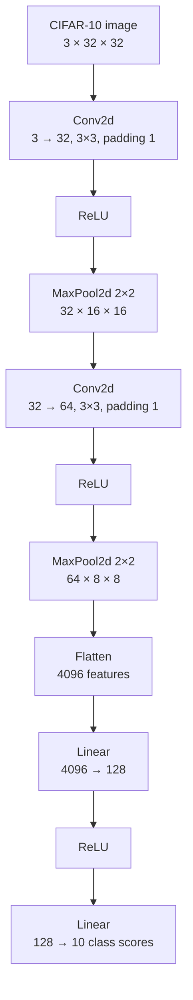
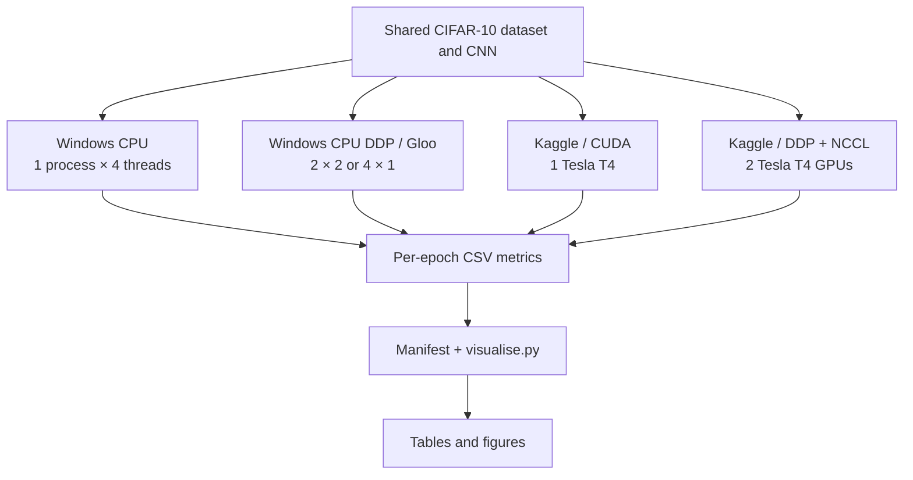
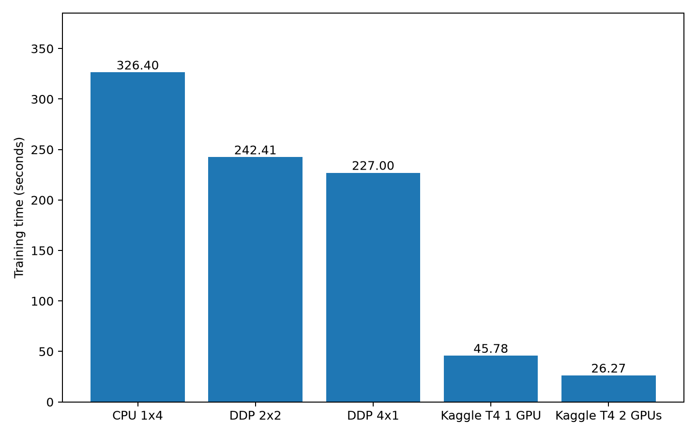
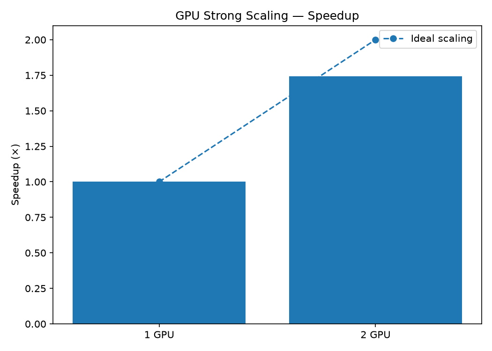
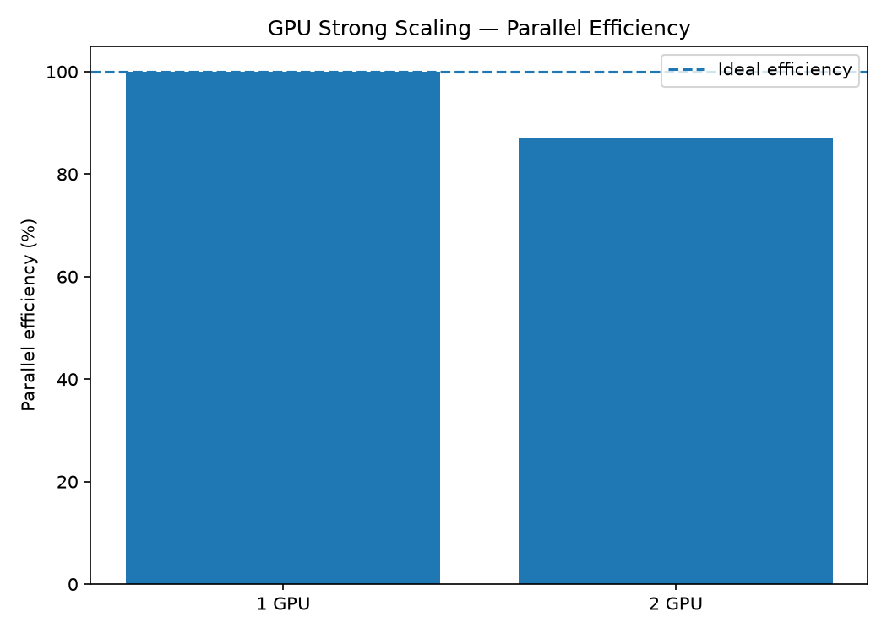

# Parallel and Distributed CIFAR-10 Training — ML Systems Optimisation

A reproducible PyTorch project comparing single-process CPU training, CPU-based Distributed Data Parallel (DDP), single-GPU training, and two-GPU DDP on the CIFAR-10 image classification task.

**Course:** ML Systems Optimisation (MLSysOps), BITS Pilani  
**Implementation:** Python, PyTorch, torchvision, Gloo, NCCL, Docker, Kaggle, Matplotlib

## 1. Overview and objectives

This project designs, implements, and evaluates parallel and distributed machine-learning training, with an emphasis on systems performance rather than maximizing model accuracy.

The objectives are to:

1. Implement a common convolutional neural network (CNN) and training pipeline for CIFAR-10.
2. Compare one, two, and four CPU training processes under a **fixed total budget of four PyTorch intra-op threads**.
3. Compare one NVIDIA Tesla T4 GPU against two T4 GPUs using synchronous data-parallel training.
4. Measure training time, throughput, speedup, parallel efficiency (where meaningful), and test accuracy.
5. Provide reproducible training commands, Docker packaging, benchmark CSVs, and generated visualizations.

## 2. Dataset — CIFAR-10

CIFAR-10 has **60,000 RGB images** of size **32 × 32**, covering 10 object classes: **50,000 training images** and **10,000 test images**. The same dataset and preprocessing are used in every benchmark.

- Preprocessing: `torchvision.transforms.ToTensor()` only.
- No image augmentation or normalization is applied in these experiments.
- Each full benchmark uses **5 epochs**, with 50,000 training images per epoch.
- Test accuracy is evaluated after every epoch, but **evaluation time is excluded** from the reported training duration.
- The dataset is downloaded into `data/` automatically and should not be committed to Git.

## 3. CNN architecture

The compact CNN contains **545,098 trainable parameters**.



**Common training settings:** Adam optimizer, learning rate `0.001`, cross-entropy loss, global batch size `128`, five epochs, seed `42`. The architecture and optimizer are held constant across the experiments.

## 4. Parallelism and implementation



### CPU training

- **Single process:** the CNN runs using four PyTorch intra-op CPU threads.
- **CPU DDP:** `torch.multiprocessing.spawn` creates two or four workers; each worker has its own model replica and a partition of the training dataset through `DistributedSampler`.
- **Gradient synchronization:** DDP synchronizes gradients during `loss.backward()` using **Gloo All-Reduce**. Each worker then updates its own matching model replica.
- **Control:** `1 × 4`, `2 × 2`, and `4 × 1` all allocate **four intra-op threads in total**. These runs investigate process/communication overhead and scheduling with a fixed thread budget; they are **not** a conventional 1-core versus 2-core versus 4-core strong-scaling experiment.

### GPU training

- **One GPU:** one process trains the CNN on `cuda:0`.
- **Two GPUs:** one process runs per T4 (`cuda:0`, `cuda:1`), and DDP synchronizes gradients via **NCCL**.
- **Global batch size:** remains 128. With two GPUs, each worker trains on 64 images per step.
- **Timing:** CUDA work is synchronized around the epoch timer; distributed elapsed time is aggregated across ranks.

### Docker

The CPU training application is packaged in a Linux Docker image using Python 3.12 and CPU-only PyTorch. Docker is used for portability and functional verification. Its short smoke-test timing is **not** included in the five full benchmark configurations.

## 5. Project layout

```text
.
├── README.md
├── pyproject.toml
├── Dockerfile
├── .dockerignore
├── src/
│   └── mlsysops_cifar10/
│       ├── __init__.py
│       ├── data.py
│       ├── model.py
│       ├── train.py
│       └── visualise.py
├── results/
│   ├── benchmarks/
│   │   ├── experiments.csv
│   │   ├── benchmark_summary.csv
│   │   └── <timestamped full-run CSV files>
│   └── figures/
│   │   └── <generated PNG figures>
│   └── profiles/
│       ├── gpu_rank0_trace.json
│       └── gpu_rank1_trace.json
├── data/                      # Downloaded CIFAR-10; Git-ignored
└── notebooks/                 # Kaggle notebook, if exported
```

Other repository directories, such as `configs/` and `tests/`, may be present. The training and visualization commands below do not depend on unused scaffolding.

## 6. Experimental configurations and results

All entries below are measurements from **one complete five-epoch run per configuration**. Throughput is computed as 250,000 training images divided by the sum of epoch training times.

| ID | Platform | Training configuration | Time (s) ↓ | Throughput (images/s) ↑ | Final test accuracy |
|---|---|---|---:|---:|---:|
| EXP-01 | Windows laptop | CPU, 1 process × 4 threads | 326.40 | 765.9 | 69.37% |
| EXP-02 | Windows laptop | CPU DDP / Gloo, 2 processes × 2 threads | 242.41 | 1,031.3 | 68.65% |
| EXP-03 | Windows laptop | CPU DDP / Gloo, 4 processes × 1 thread | 227.00 | 1,101.3 | 69.09% |
| EXP-04 | Kaggle | 1 × NVIDIA Tesla T4 / CUDA | 45.78 | 5,461.2 | 69.31% |
| EXP-05 | Kaggle | 2 × NVIDIA Tesla T4 / DDP + NCCL | **26.27** | **9,517.1** | 68.82% |

### CPU process configurations

| Experiment | Processes | Intra-op threads/process | Total allocated intra-op threads | Relative training-time speedup |
|---|---:|---:|---:|---:|
| EXP-01 | 1 | 4 | 4 | 1.00× |
| EXP-02 | 2 | 2 | 4 | 1.35× |
| EXP-03 | 4 | 1 | 4 | 1.44× |

The CPU DDP-4 configuration took about **30.5% less measured training time** than the single-process CPU baseline. As the total intra-op thread budget remains fixed, this is **observed configuration speedup**, not a claim of near-linear scaling with added CPU cores.

### GPU scaling

Using the single T4 as the **GPU-specific baseline**:

\[
S_2 = \frac{T_{1\ GPU}}{T_{2\ GPU}} = \frac{45.78}{26.27} \approx 1.74
\]

\[
E_2 = \frac{S_2}{2} \times 100\% \approx 87.1\%
\]

Two T4 GPUs reduced measured training time by approximately **42.6%** relative to one T4, at a fixed global batch size of 128. This is the project's direct two-device strong-scaling comparison. The two-GPU final accuracy (68.82%) remained close to the single-GPU accuracy (69.31%).

### CPU versus GPU

The single T4 was approximately **7.13× faster** than the Windows single-process CPU baseline by measured training time. This compares **different hardware and execution environments**, so it should not be interpreted as an isolated measurement of GPU architecture efficiency.

### Measurement scope and limitations

- `epoch_seconds` records the timed training loop, including training data loading and gradient communication within that loop; it **excludes** test-set evaluation, dataset download, process startup, and environment setup.
- The timings represent **single measurements**, without repeated trials, confidence intervals, or hardware profiling.
- CPU and GPU results were obtained on different platforms; host CPU, memory, software versions, and device properties differ.
- CPU intra-op thread counts are not the same as an exclusive allocation of physical CPU cores.
- DDP gradient synchronization is implemented, but **individual All-Reduce duration, communication overhead percentage, peak memory, and device utilization were not separately instrumented**; no quantitative breakdown is claimed.
- Small differences in final accuracy may reflect training-order and floating-point differences among configurations.

### NCCL Communication Profiling

Communication profiling was performed on Kaggle using two NVIDIA Tesla T4 GPUs with PyTorch Profiler.

The profiling experiment used 20 training batches per GPU and captured CPU operations, CUDA kernels, and NCCL collective communication.

**Key measurements (Rank 0):**

| Metric | Measurement |
|---|---:|
| NCCL All-Reduce kernel time | 32.104 ms |
| NCCL All-Reduce calls | 41 |
| Average kernel time | 0.783 ms |
| Profiled training duration | 0.73 s |

These measurements represent GPU communication activity, not necessarily communication-induced wall-clock overhead, because communication and computation may overlap.

## 7. Performance metrics and visualizations

| Metric | Definition |
|---|---|
| Epoch time | Wall-clock seconds spent in the timed training loop |
| Total training time | Sum of the five epoch times |
| Throughput | Total training images processed / total training time |
| Relative speedup | Reference training time / experiment training time |
| GPU parallel efficiency | (Single-GPU / N-GPU time) / N × 100% |
| Test accuracy | Correct predictions / 10,000 test images × 100% |

The comparison data is controlled by [`results/benchmarks/experiments.csv`](results/benchmarks/experiments.csv). Run the visualization module to regenerate `benchmark_summary.csv` and figures from the five full-run CSVs.

**Generated figures:**

| Figure | Purpose |
|---|---|
| `all_epoch_time.png` | Per-epoch times across all five configurations |
| `cpu_epoch_time.png` | CPU-only epoch time comparison |
| `cpu_throughput.png` | CPU-only epoch throughput |
| `cpu_speedup.png` | CPU process-configuration speedup (fixed thread budget) |
| `cpu_vs_gpu_time.png` | Five-run total training-time comparison |
| `cpu_vs_gpu_throughput.png` | Five-run throughput comparison |
| `accuracy_comparison.png` | Test accuracy by epoch across five runs |
| `gpu_speedup.png` | One-T4 versus two-T4 speedup and ideal scaling |
| `gpu_efficiency.png` | One-T4 versus two-T4 parallel efficiency |







## 8. Installation and usage

### Local CPU: Windows CMD

**Prerequisites:** Git, a compatible Python installation, PyTorch/torchvision, and sufficient space for CIFAR-10.

```cmd
cd /d C:\gitHub\aiml-mlsysops-parallel-cifar10
python -m venv .venv
.venv\Scripts\activate.bat
python -m pip install --upgrade pip
python -m pip install -e .
python -m pip install matplotlib
```

Use the existing virtual environment on subsequent runs; do not create it again. Check `where python` if CMD points to another project's `.venv`.

**Single-process CPU baseline:**

```cmd
python -m mlsysops_cifar10.train --device cpu --epochs 5 --batch-size 128 --processes 1 --threads 4 --seed 42
```

**CPU DDP (Gloo):**

```cmd
python -m mlsysops_cifar10.train --device cpu --epochs 5 --batch-size 128 --processes 2 --threads 2 --seed 42
python -m mlsysops_cifar10.train --device cpu --epochs 5 --batch-size 128 --processes 4 --threads 1 --seed 42
```

**Short smoke test:**

```cmd
python -m mlsysops_cifar10.train --device cpu --epochs 1 --max-batches 10 --processes 1 --threads 4
```

A smoke-test CSV has fewer than five complete epochs, so do **not** add it to `experiments.csv`.

### Docker: portable CPU execution

Start Docker Desktop in Linux-container mode, then from the repository root:

```cmd
docker build -t mlsysops-cifar10:cpu .
docker run --rm --cpus=2 --memory=4g -v "%cd%\data:/app/data" -v "%cd%\results:/app/results" mlsysops-cifar10:cpu
```

The image's default command runs a **one-epoch, ten-batch CPU smoke test**. The bind mounts persist downloads and results on the Windows host. The Docker test should not be mixed with the full-run benchmark manifest.

### Kaggle: single-GPU and multi-GPU

In a [Kaggle notebook](https://www.kaggle.com/code), select a GPU accelerator. A Kaggle **T4 ×2** session supplies two GPUs. A single-GPU command still uses only `cuda:0`.

Clone and install the project **once per fresh working environment**; substitute the repository URL if using a fork:

```python
!git clone https://github.com/arshadhs/aiml-mlsysops-parallel-cifar10.git
%cd aiml-mlsysops-parallel-cifar10
!pip install -e . --no-deps
```

The `--no-deps` option avoids replacing Kaggle's CUDA-enabled PyTorch build. After pushing local changes to GitHub, run `!git pull --ff-only` from inside the cloned repository, provided no local files would be overwritten.

**Verify accelerator:**

```python
import torch
print(torch.cuda.is_available(), torch.cuda.device_count())
print(torch.cuda.get_device_name(0))
```

**One GPU (CUDA):**

```python
!python -m mlsysops_cifar10.train --device cuda --processes 1 --epochs 5 --batch-size 128 --seed 42
```

**Two GPUs (DDP + NCCL):**

```python
!python -m mlsysops_cifar10.train --device cuda --processes 2 --epochs 5 --batch-size 128 --seed 42
```

First-time CIFAR-10 download may take time but is outside the training timer. Save or download each GPU CSV from `results/benchmarks/` before the Kaggle session ends.

### Regenerate all graphs

Ensure `experiments.csv` lists only the five completed full-run benchmarks. From the repository root:

```cmd
python -m mlsysops_cifar10.visualise
```

This regenerates [`results/benchmarks/benchmark_summary.csv`](results/benchmarks/benchmark_summary.csv) and the nine PNG figures in `results/figures/`.

## 9. Software and hardware context

| Environment | Details |
|---|---|
| Local operating system | Windows |
| Local CPU | Intel Core i7-8665U; 4 physical cores, 8 logical processors |
| Local Python | 3.14.4 |
| Local PyTorch | 2.14.1+cpu |
| Local torchvision | 0.29.1+cpu |
| Docker | Linux image, Python 3.12, CPU-only PyTorch |
| Kaggle GPU | NVIDIA Tesla T4 (one or two devices) |
| Kaggle PyTorch | 2.11.0+cu128 |

## 10. Reproducibility and next steps

The code, full-run CSV files, `experiments.csv`, and generated figures together provide an auditable record of the five experiments.

The training implementation remains in `src/mlsysops_cifar10/train.py`.

Possible future work includes repeated runs with variability estimates, profiling compute versus communication, monitoring RAM/VRAM utilization, and experimenting with a larger CNN or TPU. These extensions **were not needed to produce the reported results**.

## 11. References

- [Krizhevsky, A. — Learning Multiple Layers of Features from Tiny Images (CIFAR-10)](https://www.cs.toronto.edu/~kriz/learning-features-2009-TR.pdf)
- [PyTorch — DistributedDataParallel](https://docs.pytorch.org/docs/stable/generated/torch.nn.parallel.DistributedDataParallel.html)
- [PyTorch — DistributedSampler](https://docs.pytorch.org/docs/stable/data.html#torch.utils.data.distributed.DistributedSampler)
- [PyTorch — Distributed communication backends](https://docs.pytorch.org/docs/stable/distributed.html)
- [Docker documentation](https://docs.docker.com/)
