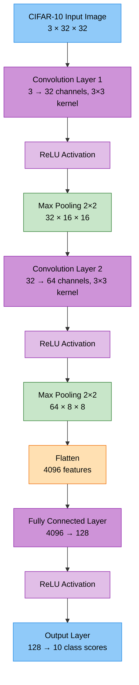
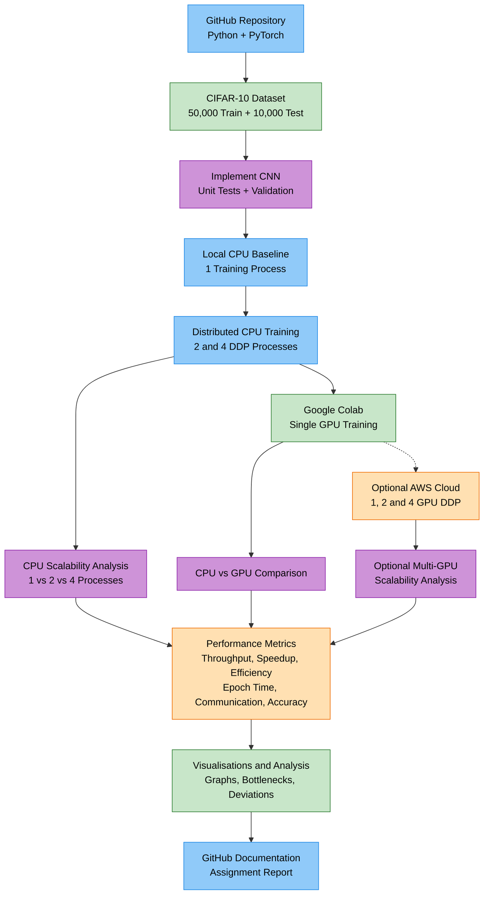

# aiml-mlsysops-parallel-cifar10

## 1. Overview

Design, implement, and evaluate a parallelised or distributed machine learning system for training an image classification model on the CIFAR-10 dataset.

## 2. Objectives

Model architecture, parallelism strategy, execution platform, and development framework — and rigorously justify each decision.

## 3. Dataset — CIFAR-10

CIFAR-10 consists of 60,000 colour images (32×32 pixels) across 10 classes (50,000 training / 10,000 test). It is a well-understood benchmark, allowing to focus effort on the systems and optimisation aspects rather than dataset preparation.

## 4. CNN Architecture



## 5. Implementation



```text
C:\gitHub\aiml-mlsysops-parallel-cifar10\
│
├── README.md
├── pyproject.toml
├── .gitignore
├── LICENSE
│
├── .github/
│   └── workflows/
│       └── tests.yml
│
├── configs/
│   ├── cpu_baseline.yaml
│   ├── cpu_ddp.yaml
│   └── gpu.yaml
│
├── src/
│   └── mlsysops_cifar10/
│       ├── __init__.py
│       ├── config.py
│       ├── data.py
│       ├── model.py
│       ├── train.py
│       ├── evaluate.py
│       ├── distributed.py
│       ├── metrics.py
│       └── utils.py
│
├── experiments/
│   ├── benchmark.py
│   ├── profile.py
│   └── plot_results.py
│
├── notebooks/
│   └── colab_gpu.ipynb
│
├── tests/
│   ├── test_data.py
│   ├── test_model.py
│   ├── test_training.py
│   └── test_distributed.py
│
├── docs/
│   ├── architecture.md
│   ├── methodology.md
│   ├── experiments.md
│   └── findings.md
│
├── results/
│   ├── README.md
│   ├── benchmarks/
│   └── figures/
│
├── report/
│   └── assignment-report.docx
│
├── data/                  # Git ignored
├── checkpoints/           # Git ignored
└── runs/                  # Git ignored

```

## 6. Technology Stack

## 7. Experimental Configurations

| ID | Platform | Workers | Configuration | Objective |
|---|---|---:|---|---|
| EXP-01 | Local CPU | 1 | Single-process training | Establish baseline performance |
| EXP-02 | Local CPU | 2 | PyTorch DDP (Gloo) | Measure CPU parallel speedup |
| EXP-03 | Local CPU | 4 | PyTorch DDP (Gloo) | Evaluate CPU scalability |
| EXP-04 | Google Colab GPU | 1 | CUDA training | Evaluate GPU acceleration |
| EXP-05 | AWS Cloud GPU (Optional) | 1, 2, 4 | PyTorch DDP (NCCL) | Evaluate multi-GPU scalability |

**Proposed CPU Worker Allocation:**

| Experiment | DDP Processes | Intra-op Threads per Process | Total Intra-op Threads |
|---|---:|---:|---:|
| EXP-01 | 1 | 4 | 4 |
| EXP-02 | 2 | 2 | 4 |
| EXP-03 | 4 | 1 | 4 |

**Experimental Controls**

To ensure meaningful comparisons:

- Use the same CNN architecture and CIFAR-10 dataset.
- Maintain a consistent global batch size for worker-scaling experiments.
- Use consistent training epochs, optimisation settings, and random seeds where practical.
- Ensure the complete training dataset is processed per epoch.
- Record hardware specifications and software versions.
- Repeat benchmark runs to reduce measurement variability.
- Measure CPU worker scaling independently of CPU-to-GPU hardware acceleration.

**Expected Analysis**

The experiments will investigate:

1. Whether increasing workers reduces training time.
2. Whether throughput increases with parallelism.
3. How parallel efficiency changes as workers increase.
4. Whether communication and synchronisation introduce significant overhead.
5. Whether distributed training maintains comparable classification accuracy.
6. How GPU acceleration compares with CPU execution.


## 8. Performance Metrics

The system will measure the following performance metrics to evaluate parallel and distributed CNN training.

**Required Metrics**

| Metric | Formula / Measurement | Purpose |
|---|---|---|
| Speedup | S(N) = T₁ / Tₙ | Measures acceleration compared with single-worker training |
| Parallel Efficiency | E(N) = S(N) / N × 100% | Measures how effectively parallel workers are utilised |
| Communication Cost | Synchronisation / All-Reduce time per step | Measures distributed communication overhead |
| Response Time | Wall-clock time per training epoch | Measures end-to-end epoch duration, including data loading and synchronisation |
| Accuracy Gap | Acc₁ − Accₙ | Measures classification accuracy differences between baseline and parallel training |

Where:

- **T₁:** Training time using one worker.
- **Tₙ:** Training time using N workers.
- **N:** Number of parallel training workers.
- **Acc₁:** Test accuracy using one worker.
- **Accₙ:** Test accuracy using N workers.

**Additional Metrics**

| Metric | Formula / Measurement | Purpose |
|---|---|---|
| Throughput | Images processed / Training time | Measures training samples processed per second |
| Total Training Time | Wall-clock duration of the complete training run | Measures overall training cost |
| Convergence | Test accuracy versus elapsed training time | Evaluates how quickly the model learns |
| Communication Overhead (%) | Communication time / Training time × 100% | Estimates communication overhead as a proportion of execution time |
| CPU / GPU Utilisation | Hardware utilisation measurements | Helps identify underutilised computing resources |
| Memory Usage | Peak CPU RAM / GPU memory consumption | Evaluates hardware resource requirements |

Communication and computation may overlap during DDP execution. Communication timings and overhead percentages will therefore be reported with their measurement methodology clearly identified.

**Planned Performance Visualisations**

The following graphs will be generated from measured experimental results:

1. **Workers vs Training Time** — How training duration changes as worker count increases.
2. **Workers vs Speedup** — Actual speedup compared with ideal linear speedup.
3. **Workers vs Parallel Efficiency** — Efficiency changes as parallelism increases.
4. **Workers vs Throughput** — Images processed per second.
5. **Computation vs Communication Time** — Distribution of execution time across major operations.
6. **Accuracy vs Training Time** — Model convergence across configurations.
7. **CPU vs GPU Training Performance** — Hardware acceleration comparison.

**Performance Evaluation Objectives**

The evaluation will determine:

- Whether parallelism improves training performance.
- Whether additional workers produce proportional speedup.
- What limits system scalability.
- Whether communication overhead outweighs computational benefits.
- Whether model accuracy remains comparable across configurations.
- Which configuration offers the best balance of training time, efficiency, and computing resources.

The experiments will evaluate both successful speedups and performance degradation, supported by measured results and bottleneck analysis.

## 9. Results and Analysis

Performance results and analysis will be added after the CPU and GPU benchmark experiments are completed.

## 10. Installation and Usage

### Prerequisites
- Python 3.10+ with compatible PyTorch packages
- Git
- Windows, Linux or macOS
- GPU optional

### Environment Setup (Windows CMD)

```cmd
cd /d C:\gitHub\aiml-mlsysops-parallel-cifar10

python -m venv .venv
.venv\Scripts\activate.bat

python -m pip install --upgrade pip
python -m pip install -e ".[dev]"
```

Create the virtual environment only once.
For later sessions, activate the existing environment.

### Verify PyTorch

```cmd
python -c "import torch; print(torch.__version__)"
```

### Run Dataset Tests

```cmd
python -m pytest tests/test_data.py -v
```

### Local Verified Environment

- Python: 3.14.4
- PyTorch: 2.14.1+cpu
- Torchvision: 0.29.1+cpu
- CPU: Intel Core i7-8665U
- Physical cores: 4
- Logical processors: 8
- CIFAR-10: 50,000 training / 10,000 testing images
- Dataset tests: 4 passed


## 11. References